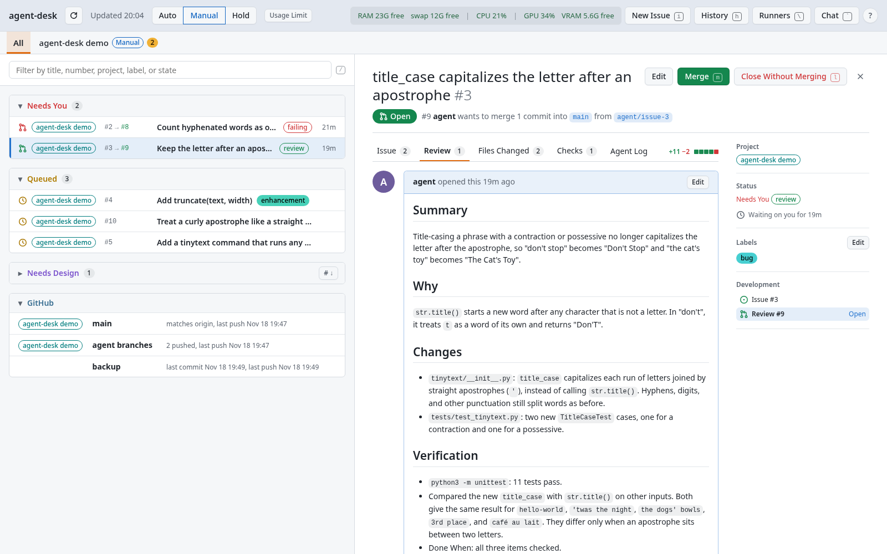
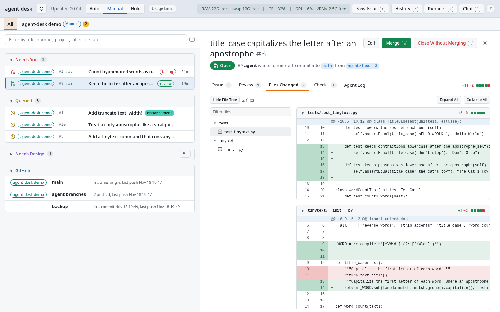
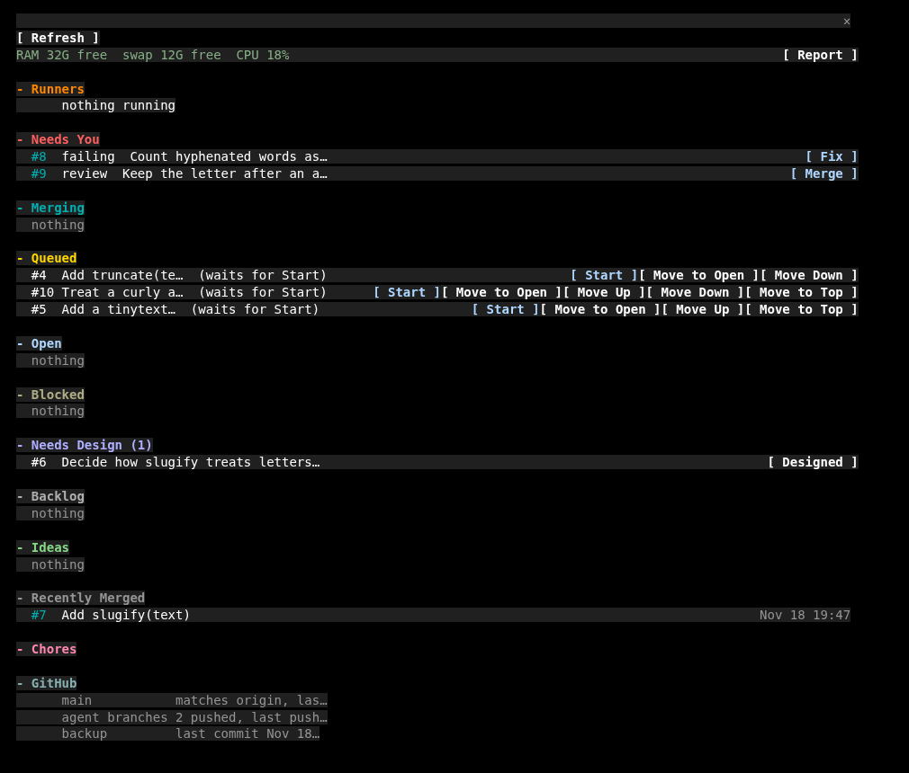
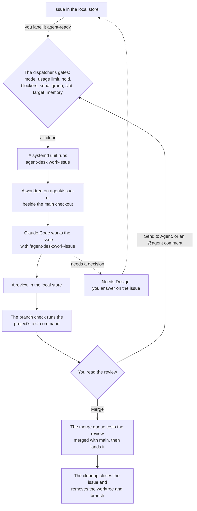

# agent-desk

agent-desk hands a project's issues to headless Claude Code agents and brings their work back as reviews for you to
read. You file an issue, label it `agent-ready`, and agent-desk starts an agent in a worktree of its own. The agent
writes the change, runs the tests, and opens a review. You read the diff, send the agent back with a comment, or press
Merge. A web page and a pane beside the Claude Code chat show what each agent works on and what waits for you.

Everything runs on your machine. Issues and reviews live in a local SQLite store, the dispatcher starts each run as a
systemd unit with its own time limit and memory claim, and each branch's tests run here before anything merges. One
copy serves every project you register. GitHub is optional: agent-desk can push `main` and agent branches to it and
publish releases there, and a project kept only on your machine needs no GitHub account at all.



## Prerequisites

agent-desk runs on Linux with systemd. `agent-desk doctor` checks each of these and says how to fix what's missing:

- A systemd user manager that `systemctl --user` reaches, and cgroup v2 mounted at `/sys/fs/cgroup`.
- `git`, `python3`, Node 24 or newer, `flock` from util-linux, and `loginctl` and `busctl` from systemd.
- A git identity the agents commit their work with: `git config --global user.name "Your Name"` and
  `git config --global user.email you@example.com`.
- [Claude Code](https://claude.com/claude-code), signed in to the account the agents run on.
- On a machine without a desktop session, lingering, so the timers keep running after you log out:
  `sudo loginctl enable-linger $USER`.

GitHub and a `gh` login are optional. A project whose `.agent-desk.json` sets `"host": "github"` uses `gh` only to
publish releases and to import issues from GitHub, and a project whose `host` is `none` needs neither. Read
[SECURITY.md](SECURITY.md) before you start: it says who can start a run on your machine and what an agent can reach.

## Quickstart

This walk-through installs agent-desk, sets up a copy of [agent-desk-demo](https://github.com/erjand/agent-desk-demo),
a small Python package made for trying agent-desk, and has an agent work one issue into a review you merge.

### Install

Install the plugin, which holds the pane and the agents' skills, and clone this repository for the `agent-desk`
command:

```bash
claude plugin marketplace add erjand/agent-desk
claude plugin install agent-desk
git clone https://github.com/erjand/agent-desk ~/agent-desk
~/agent-desk/install.sh
```

`install.sh` links `~/.local/bin/agent-desk` to the clone and says so when `~/.local/bin` is missing from your PATH.
Then turn on the services, which serve every project you register:

```bash
agent-desk dispatch install   # the dispatcher, which starts every run
agent-desk chores on          # the timers that move the merge queue, fix conflicts, and run chores
agent-desk web on             # the web page at http://127.0.0.1:7480
agent-desk backup install     # the backup timer, which backs up the local store every 15 minutes
```

The backup timer commits every issue, review, and comment as JSON to a git repository at `~/dev/repo/agent-desk-data`,
or the folder `AGENT_DESK_DATA` names when `backup install` runs, and copies the whole database to a snapshot once a
day, keeping seven days of snapshots. Without the timer, agent-desk keeps no backup. [Backup and
restore](docs/reference.md#backup-and-restore) says how to push the repository to a remote and restore from either.

To work on agent-desk itself, clone it and run `./install.sh` without the marketplace plugin, as
[CONTRIBUTING.md](CONTRIBUTING.md) describes.

### Set up the demo project

Clone the demo and keep it on this machine, so the desk pushes nothing:

```bash
git clone https://github.com/erjand/agent-desk-demo ~/agent-desk-demo
cd ~/agent-desk-demo
git remote remove origin
sed -i 's/"host": "github"/"host": "none"/' .agent-desk.json
git commit -qam "Keep the demo on this machine"
agent-desk install demo/agent-desk-demo
agent-desk doctor
```

`agent-desk install` records the checkout and registers the project in the local store. `agent-desk doctor` should
end with `0 failed`; follow the fix under any failure, and see [Troubleshooting](#troubleshooting).

### Work an issue

1. Open <http://127.0.0.1:7480>. The demo's tab shows an empty board.
2. Press New Issue, or `i`, and file an issue such as this one, with the Agent-Ready box checked:

   > **Add truncate(text, width)**
   >
   > Add `truncate(text, width)` to `tinytext`. It cuts the text at the last word boundary that fits in `width`
   > characters and adds `…`, and returns text that already fits unchanged. Add tests.

   From a terminal, `agent-desk issue create --title "..." --body "..." --label agent-ready` in the demo's checkout
   does the same.
3. The card moves to Queued, then to Working once the dispatcher starts the agent. Its Agent Log tab shows what the
   agent does. A run takes a few minutes on a task this size.
4. When the agent finishes, the card moves to Needs You with its review. Read the review's description and Files
   Changed, and check that its branch check passed.

   

5. To ask for a change, comment on a line of the diff, or write in the review's comment box, and press Send to
   Agent. The agent goes back to the same branch and the card returns to Needs You when it finishes.
6. Press Merge. The merge queue tests the review merged with `main` and fast-forwards `main`, and the cleanup closes
   the issue and removes the worktree and branch.

To watch from Claude Code instead, run `/agent-desk` in a session in the demo's checkout. The pane docks beside the
chat with the same board and buttons. It lists a review without its description or diff, and pressing the review
opens it on the web page. To read it from a terminal, run `agent-desk review view <n>` for its description, comments,
and branch, then `git diff main...<branch>` in the demo's checkout for its changes.



### Set up your own project

Run `agent-desk install` from your project's main checkout. It writes a starter `.agent-desk.json` when the project
has none. Fill in its `test` command, as [Configuration](#configuration) describes, and add an Agent desk section to
the project's AGENTS.md, then commit both and run `agent-desk doctor`. A project with no remote, or one whose origin
is a path on disk, takes its name as an argument: `agent-desk install <owner>/<repo>`.

## How work flows



1. You label an issue `agent-ready`. It waits in Queued until the dispatcher's gates clear: the desk's mode lets it
   start, no open issue blocks it, no other issue holds its serial group, the project has a free agent slot, and the
   machine has the memory. The project's queued issues keep one start order, which you can change by dragging cards.
2. The dispatcher starts `agent-desk work-issue <n>` as a systemd unit. The agent works in `../<repo>-issue-<n>` on
   the branch `agent/issue-<n>`, commits as it goes, and opens a draft review at its first commit, so the work
   survives the run's time limit.
3. Each time the branch moves, the dispatcher tests its newest commit merged with `main`, running the project's
   `test` command in a scratch worktree. The agent marks the review ready once its check passes.
4. An agent that needs your call moves the issue to Needs Design and asks under `## Decisions Needed`, with numbered
   questions and lettered options, so you can answer `1B`. A comment sent to the agent on the issue or the review
   starts another run on the same branch.
5. Merge adds the review to the merge queue, which tests it merged with the newest `main`, lands it, and runs the
   project's sync command. The cleanup then closes the issue and removes the worktree and branch.

The same dispatcher runs the rest of the desk's work, each as a unit with its own log: chores such as a weekly audit
or refactor, fixes that resolve a review's conflicts with `main`, and discussions of issues labelled `idea`. Auto,
Manual, and Hold, in the web page's header, decide whether new runs start on their own, only when you press Start,
or not at all. [The reference](docs/reference.md) describes each part in detail, starting from the
[issue lifecycle](docs/reference.md#issue-lifecycle).

## Configuration

Each project commits a `.agent-desk.json` in its main checkout:

```json
{
  "title": "Lantern Game",
  "host": "github",
  "test": "just test",
  "worktree": { "seeds": [".godot/imported"], "setup": "just build" },
  "sync": { "run": "just build", "skipWhile": ["godot"] },
  "chores": { "every": { "refactor": 3 } }
}
```

| Key | What it sets |
| --- | --- |
| `title` | The project's name on the page and in the pane |
| `host` | `github` to push `main` and publish releases there, or `none` for a project kept on this machine |
| `test` | The command each branch check runs; empty turns the checks off, so reviews merge untested |
| `testMinutes`, `limitMinutes` | The time limits of a branch check and of each kind of run |
| `env` | Environment variables each run and check gets |
| `slots` | How many agent, chore, fix, and check runs the project runs at once |
| `worktree` | Paths copied into each new worktree, and a command that sets it up |
| `sync` | A command run in the main checkout after the merge queue moves `main` |
| `chores` | The chore skills the project runs and the days between their runs |
| `fixes`, `resources`, `presence`, `models` | Conflict fixes, memory limits, when chores start, and each run's model |

[The config](docs/reference.md#the-config) in the reference gives every key with its default.

Add an Agent desk section to the project's AGENTS.md, or to its CLAUDE.md when its AGENTS.md is shared beyond the
project. The `/agent-desk:work-issue` and `/agent-desk:create-issue` skills read it for the test command, how agents
show a visual change, which files make an issue `serial`, and where design docs and ideas live.

## Troubleshooting

Run `agent-desk doctor` from a project's checkout first. It marks each check `ok`, `warn`, or `fail`, prints a fix
under each warning and failure, and exits 1 when a check fails.

| `doctor` reports | What to do |
| --- | --- |
| A command isn't on PATH, or Node is older than 24 | Install it; the fix names the package |
| git has no `user.name` or `user.email` for this account | Set them with the `git config --global` commands doctor prints |
| `systemctl --user` can't reach the user's manager | Log in to a session with a systemd user manager, or enable lingering |
| `/sys/fs/cgroup` isn't cgroup v2 | Boot with `systemd.unified_cgroup_hierarchy=1` |
| `agent-desk` isn't on PATH, or runs another checkout | Run `install.sh` from the clone that should be live |
| Claude Code loads no agent-desk plugin, or two | Run `install.sh`, and remove the extra plugin it names |
| The plugin's version differs from the clone's, or lacks a skill | Run `claude plugin update agent-desk`, or pull the clone |
| The state folder is open to other accounts | `chmod 700 ~/.local/state/agent-desk` |
| Files left from an older agent-desk | Delete them with the `rm -r` command doctor prints |
| The local store is missing, unreadable, or fails SQLite's quick check | Run `agent-desk install` in a project, or restore it as [Backup and restore](docs/reference.md#backup-and-restore) describes |
| The store's schema is newer than the checkout | Pull the clone that `agent-desk` on PATH runs |
| The weekly usage limit can't read usage | Sign in to Claude Code again, or run `agent-desk usage-limit off` |
| The dispatcher, a timer, or the web page isn't active, or runs another checkout | Run the command doctor names, such as `agent-desk dispatch install` |
| `agentdesk.slice` is missing or differs | Run `agent-desk dispatch install` |
| No desktop session and no lingering | `sudo loginctl enable-linger $USER` |
| `.agent-desk.json` is missing or fails a check | Run `agent-desk install`, or fix the line doctor names |
| The config sets no `test` command | Set `test`, or accept that the project's reviews merge untested |
| The projects file or the store doesn't record the checkout | Run `agent-desk install` from the main checkout |
| `gh` is missing or logged out, for a `github` project | Install `gh` and run `gh auth login`, or set `host` to `none` |
| GitHub has an open PR from an `agent/*` branch | Open a review for the branch with `agent-desk review create`, and close the PR |
| Claude Code finds no skill for a chore | Install the skill, or take it out of `chores.every` |

When another program holds port 7480, run `AGENT_DESK_WEB_PORT=7481 agent-desk web on` to serve the web page on
another port. The service keeps the port through upgrades, and the pane opens items there.

When a run fails, its card in Needs You names the `journalctl --user -u <unit>` command that prints its log, and the
Agent Log tab shows the agent's session. `journalctl --user -u agent-desk-dispatch` prints the dispatcher's log, and a
waiting card's note says which gate holds it, such as `waits for memory: 5.3 GB free of 9 GB needed`.

## Upgrade

1. Pull the clone that `agent-desk` on PATH runs.
2. Run `./install.sh` from it, which points the command, the plugin, and the systemd user units at the clone again.
   With the plugin installed from the marketplace, also run `claude plugin update agent-desk` and restart Claude Code.
3. Run `agent-desk doctor` from each project's main checkout, and follow the fix under each warning and failure.

[CHANGELOG.md](CHANGELOG.md) lists what each release changed and marks what breaks with **Breaking**.
[Installing and upgrading](docs/reference.md#installing-and-upgrading) says which services to restart.

## Documentation

- [docs/reference.md](docs/reference.md): every command and config key, and how each part works, from the dispatcher
  and the merge queue to the pane, the web page, the local store, backups, and releases.
- [CONTRIBUTING.md](CONTRIBUTING.md): how to run the tests and how a change reaches `main`.
- [SECURITY.md](SECURITY.md): who can start a run, what an agent can reach, and how to report a vulnerability.
- [CHANGELOG.md](CHANGELOG.md): what each release changed.

## License

agent-desk is under the MIT license in [`LICENSE`](LICENSE). The web page's vendored Preact, htm, and marked keep their
own licenses, which [`THIRD_PARTY_NOTICES.md`](THIRD_PARTY_NOTICES.md) lists.
